<div align="center">


<h3>동아리 운영과 커뮤니티를 한 곳에서</h3>

출석, 게시판, 멤버 관리, 어드민까지. 동아리에 필요한 기능을 하나의 서비스로 묶었습니다.

<br />

[](https://nextjs.org/)
[](https://react.dev/)
[](https://www.typescriptlang.org/)
[](https://capacitorjs.com/)

[**weeth.kr 바로가기**](https://weeth.kr)

<sub>[미리보기](#미리보기) · [주요 기능](#주요-기능) · [기술 스택](#기술-스택) · [시작하기](#시작하기) · [프로젝트 구조](#프로젝트-구조)</sub>

</div>

<br />

## 소개

Weeth는 동아리 운영에서 반복되는 일들을 하나의 서비스로 정리했습니다. 한 번 가입하면 여러 동아리를 넘나들며 활동할 수 있고, 클럽 컨텍스트는 URL로 전환됩니다. 웹과 iOS·Android를 하나의 코드베이스(Capacitor)로 서비스하며, React Server Components를 바탕으로 가볍게 동작합니다.

<table>
<tr>
<td width="50%" valign="top">

**회원은 이렇게 써요**

- 세션마다 QR·코드로 간편하게 출석
- 공지 확인하고 게시판에서 소통
- 캘린더로 다가오는 일정 확인
- 내 출석률·회비 납부 상태 확인

</td>
<td width="50%" valign="top">

**운영진은 이렇게 써요**

- 세션 생성하고 출석 관리
- 멤버·기수·페널티 관리
- 게시판 개설 및 권한 설정
- 회비·거래 내역 관리

</td>
</tr>
</table>

<br />

## 미리보기

### 데스크톱 — 사용자 화면

<table>
  <tr>
    <td width="50%">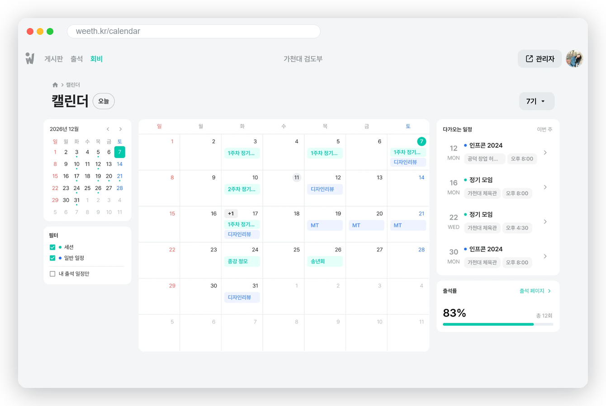</td>
    <td width="50%">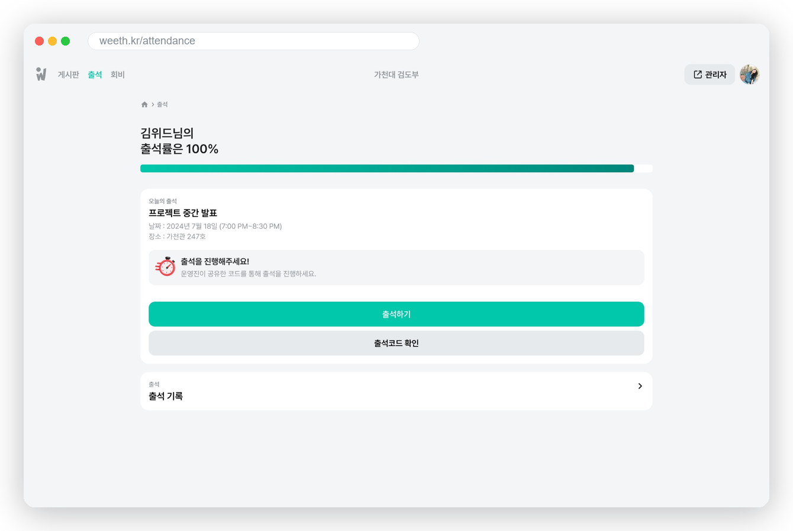</td>
  </tr>
  <tr>
    <td align="center"><sub>캘린더</sub></td>
    <td align="center"><sub>출석</sub></td>
  </tr>
  <tr>
    <td width="50%">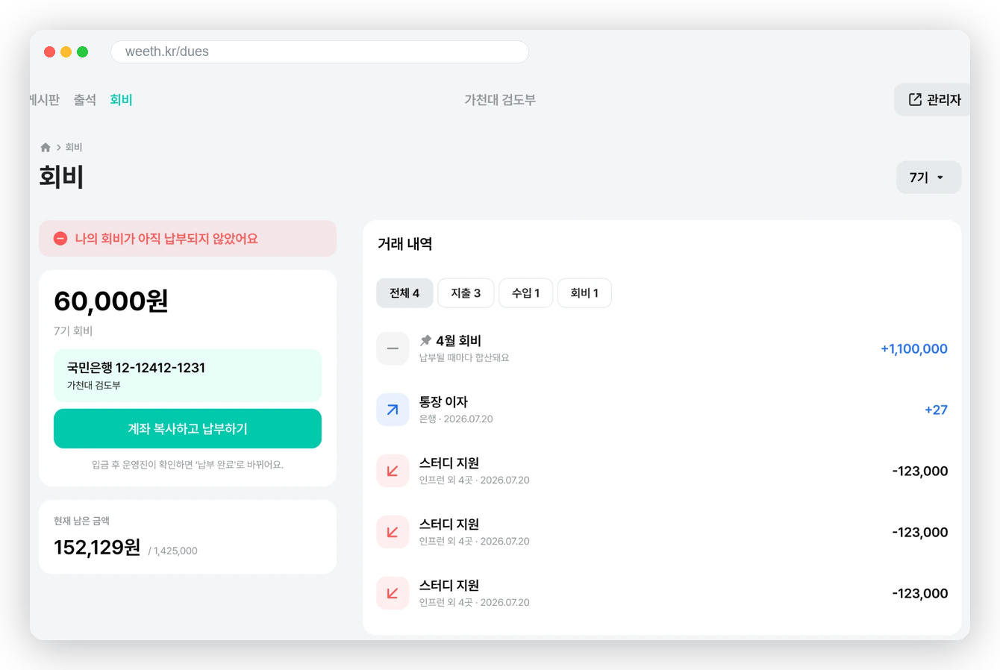</td>
    <td width="50%">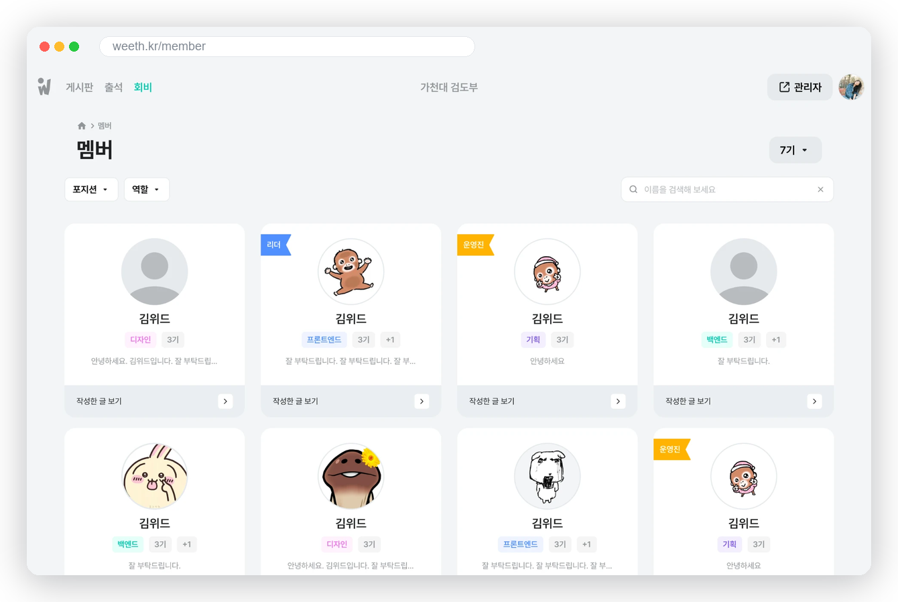</td>
  </tr>
  <tr>
    <td align="center"><sub>회비</sub></td>
    <td align="center"><sub>멤버</sub></td>
  </tr>
  <tr>
    <td width="50%">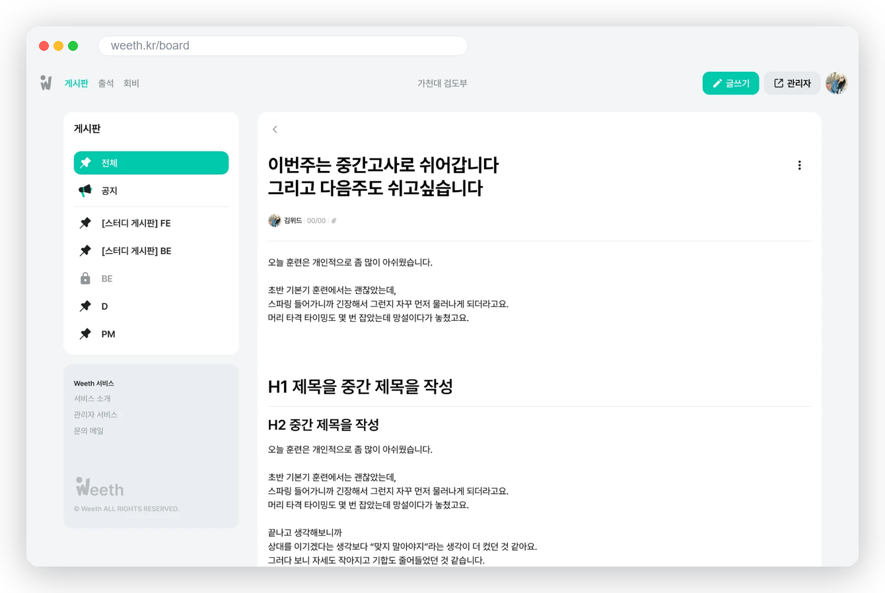</td>
    <td width="50%">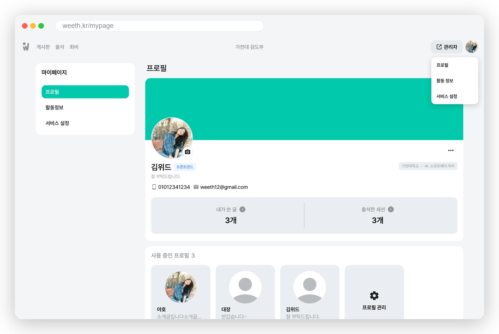</td>
  </tr>
  <tr>
    <td align="center"><sub>게시판</sub></td>
    <td align="center"><sub>마이페이지</sub></td>
  </tr>
</table>

### 데스크톱 — 운영진(어드민) 화면

<table>
  <tr>
    <td width="50%">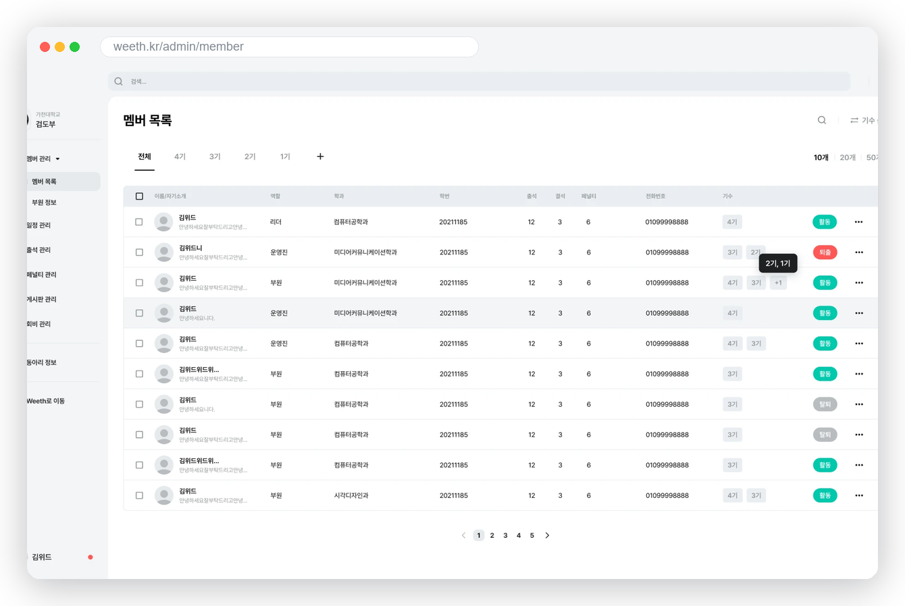</td>
    <td width="50%">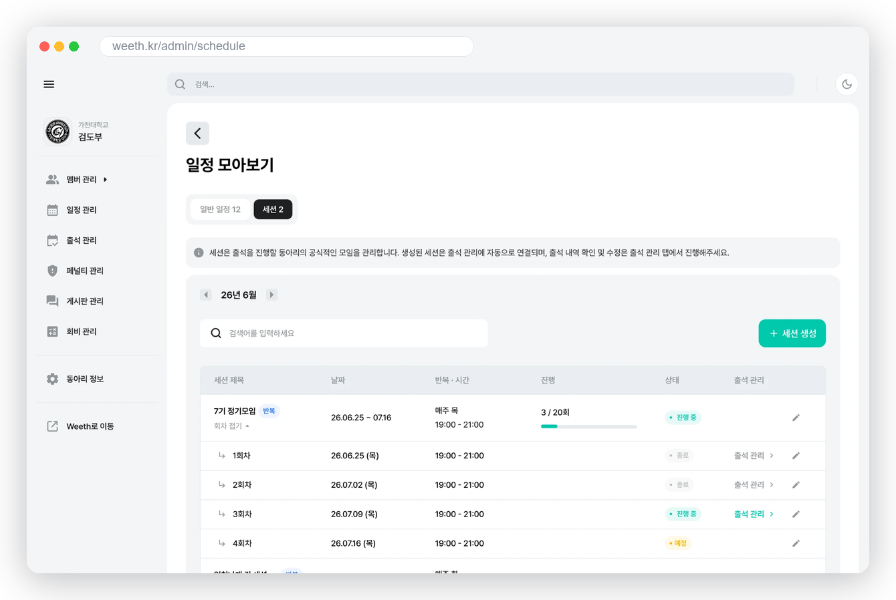</td>
  </tr>
  <tr>
    <td align="center"><sub>멤버 관리</sub></td>
    <td align="center"><sub>세션 관리</sub></td>
  </tr>
  <tr>
    <td width="50%">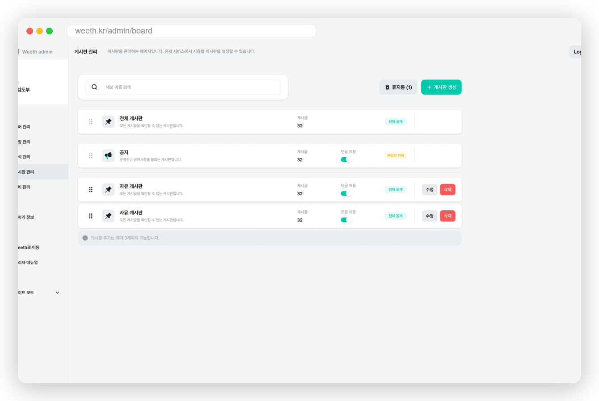</td>
    <td width="50%">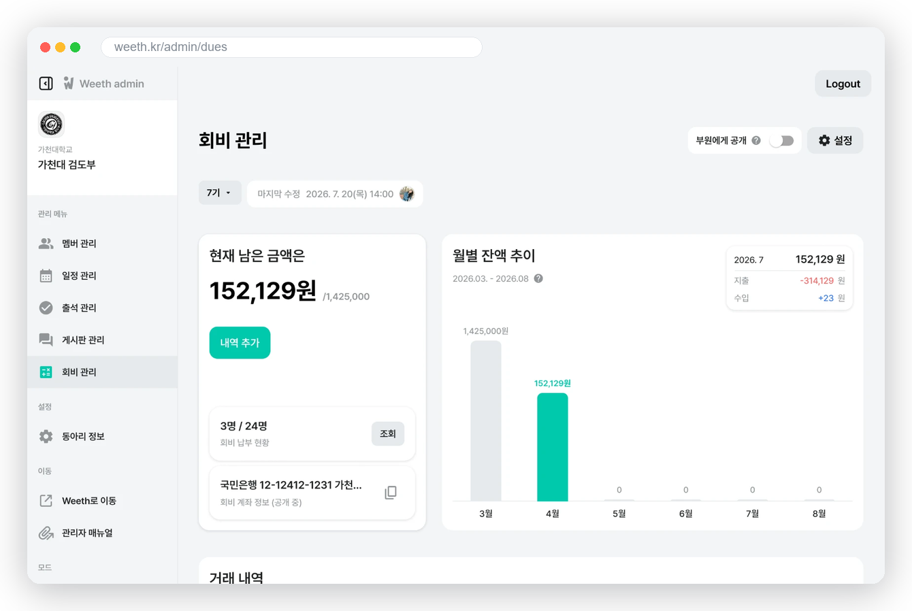</td>
  </tr>
  <tr>
    <td align="center"><sub>게시판 관리</sub></td>
    <td align="center"><sub>회비 관리</sub></td>
  </tr>
</table>

### 모바일

<table>
  <tr>
    <td width="25%">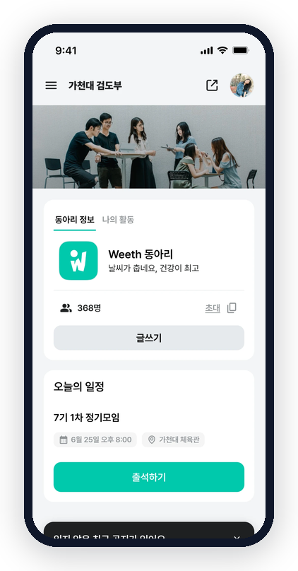</td>
    <td width="25%">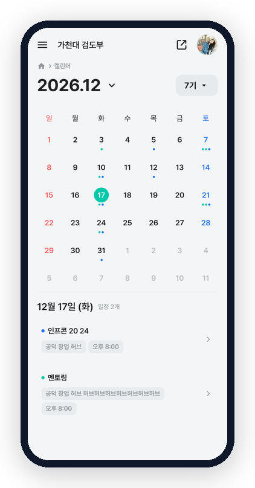</td>
    <td width="25%">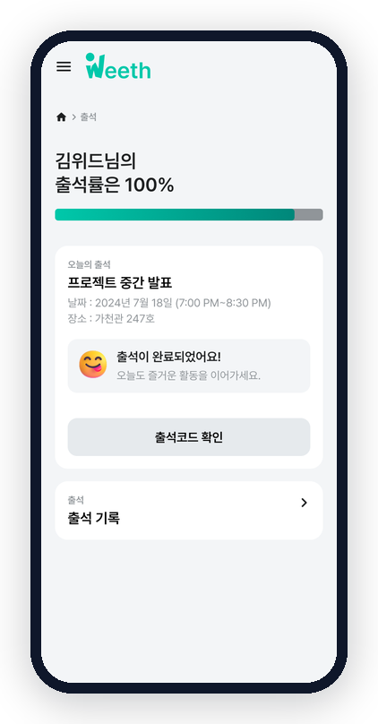</td>
    <td width="25%">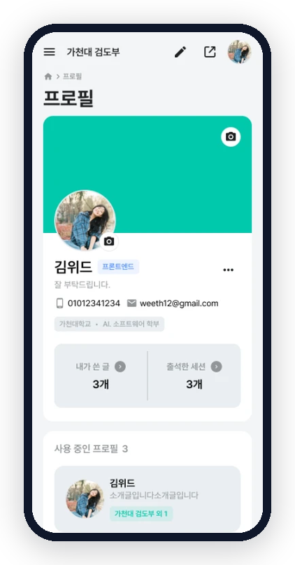</td>
  </tr>
  <tr>
    <td align="center"><sub>홈</sub></td>
    <td align="center"><sub>캘린더</sub></td>
    <td align="center"><sub>출석</sub></td>
    <td align="center"><sub>마이페이지</sub></td>
  </tr>
</table>

<br />

## 주요 기능

<table>
<tr>
<td width="50%" valign="top">

### 인증
쿠키 기반 인증 · Apple·Kakao 소셜 로그인

</td>
<td width="50%" valign="top">

### 게시판
tiptap 리치 에디터 · 공지/일반 게시판 · 댓글·대댓글·좋아요

</td>
</tr>
<tr>
<td valign="top">

### 출석
세션별 출석 코드 · QR 스캔 · 실시간 출석 현황

</td>
<td valign="top">

### 마이페이지
프로필 · 활동 기수(Cardinal) · 출석 통계

</td>
</tr>
<tr>
<td valign="top">

### 어드민
멤버 · 게시판 · 일정 · 출석 · 클럽 정보 관리 대시보드

</td>
<td valign="top">

### 기능 플래그
Flagsmith 기반 클럽별 기능 On/Off · 버전 분기

</td>
</tr>
</table>

<br />

## 기술 스택

<table>
  <tr>
    <td><b>Core</b></td>
    <td>
      
      
      
    </td>
  </tr>
  <tr>
    <td><b>Styling</b></td>
    <td>
      
      
      
    </td>
  </tr>
  <tr>
    <td><b>State · Data</b></td>
    <td>
      
      
      
      
    </td>
  </tr>
  <tr>
    <td><b>Editor</b></td>
    <td>
      
    </td>
  </tr>
  <tr>
    <td><b>Mobile</b></td>
    <td>
      
    </td>
  </tr>
  <tr>
    <td><b>Testing</b></td>
    <td>
      
      
      
      
    </td>
  </tr>
  <tr>
    <td><b>Infra · Tooling</b></td>
    <td>
      
      
      
      
      
    </td>
  </tr>
</table>

React Compiler가 켜져 있어 `useMemo`, `useCallback`, `React.memo`는 대부분 필요하지 않습니다.

<br />

## 시작하기

이 프로젝트는 pnpm만 사용합니다. (npm·yarn 사용 금지)

```bash
pnpm install   # 의존성 설치
pnpm dev       # 개발 서버 실행
```

실행 후 [http://localhost:3000](http://localhost:3000) 에서 확인할 수 있습니다.

### 모바일 (Capacitor)

프로덕션 URL(`https://weeth.kr`)을 띄우는 하이브리드 앱 구조입니다.

```bash
pnpm cap:dev:ios        # 로컬 개발 서버로 iOS 실행
pnpm cap:dev:android    # 로컬 개발 서버로 Android 에뮬레이터 실행
pnpm cap:prod:sync      # 프로덕션 URL을 네이티브 프로젝트에 동기화
pnpm cap:open:ios       # Xcode 열기
pnpm cap:open:android   # Android Studio 열기
```

`CAP_SERVER_URL` 환경 변수로 웹 서버 주소를 덮어쓸 수 있습니다.

<br />

## 스크립트

| 명령어 | 설명 |
| --- | --- |
| `pnpm dev` | 개발 서버 |
| `pnpm build` | 프로덕션 빌드 |
| `pnpm lint` | ESLint 검사 |
| `pnpm format:check` | Prettier 포맷 검사 |
| `pnpm typecheck` | 타입 검사 (`tsc --noEmit`) |
| `pnpm test` | Jest 테스트 |
| `pnpm test:e2e` | Playwright E2E 테스트 |
| `pnpm analyze` | 번들 사이즈 분석 |
| `pnpm generate:types` | Swagger에서 API 타입 생성 |

<br />

## 프로젝트 구조

```text
src/
├── app/                  # Next.js App Router
│   ├── (private)/        # 인증 필요 — [clubId] 기반 메인 / 어드민
│   ├── (public)/         # 인증 불필요 — 로그인 · 랜딩 · 클럽 공개 페이지
│   └── globals.css       # 디자인 토큰 (CSS 변수 · @utility)
├── components/           # ui / layout / 도메인별 컴포넌트
├── lib/
│   ├── actions/          # Server Actions ("use server")
│   ├── apis/             # API 호출 함수
│   └── cn.ts             # className 머지 유틸
├── stores/               # Zustand 전역 상태
├── hooks/                # 커스텀 훅
├── flags/                # Flagsmith 기능 플래그
└── types/                # 타입 정의
```

`[clubId]` 동적 세그먼트가 곧 클럽 컨텍스트입니다. 사용자는 URL을 따라 클럽을 바꿔가며 활동합니다.

<br />

<div align="center">
<sub>Team Weeth</sub>
</div>
